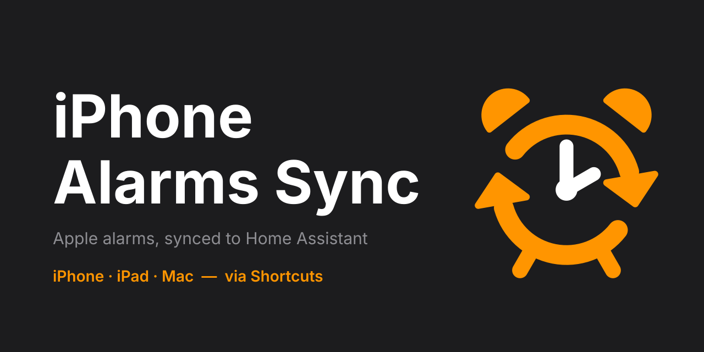

<p align="center">
  
</p>

<h1 align="center">iPhone Alarms Sync</h1>

<p align="center">
  
  
  
  
  
  
  <a href="https://github.com/frinyvonnick/gitmoji-changelog"></a>
</p>

<p align="center">
  <a href="https://my.home-assistant.io/redirect/hacs_repository/?owner=Jozwiaczek&repository=iphone-alarms-sync&category=integration"></a>
</p>

Sync iPhone/iPad alarms to Home Assistant using predefined Apple Shortcuts. This is a **one-way synchronization** from Apple iPhone or iPad to Home Assistant, enabling alarm-based automations like turning on lights, brewing coffee, or opening blinds when your alarm goes off.

## ✨ Features

### Alarm Synchronization
- **Sync on closing the Clock app** - an iOS automation sends all alarms to Home Assistant when you close the Clock app
- **Changes and deletions** - each sync updates times, repeat days and the enabled state; alarms deleted on the phone are removed with their device
- **One device per alarm** - every alarm gets its own device and entities
- **Wake-Up alarm** - dedicated tracking of the iOS Wake-Up (Sleep schedule) alarm

### Event Tracking
- **Alarm events** - goes off, snoozed and stopped, per alarm or for any alarm
- **Sleep events** - bedtime starts, wind down starts, waking up
- **Timestamps** - the last time of each event type
- **Missed event warning** - a sensor turns on when an alarm rang but its event never reached Home Assistant

### Smart Home Integration
- **Device triggers** and an **event** for automations
- **Sensors** - next alarm, next occurrence per alarm, last sync, repeat schedule
- **Several iPhones/iPads** - add the integration once per device

## 🚀 Installation

**Requirements:** Home Assistant 2026.8 or newer, iOS 17+ and the Home Assistant app 2026.9.3 or newer.

### Step 1: Install from the Marketplace

1. Click **Open in the Marketplace** above, or go to Settings → Marketplace and search for "iPhone Alarms Sync"
2. Download "iPhone Alarms Sync"
3. Restart Home Assistant

On Home Assistant 2026.8–2026.10 the button opens HACS instead.

### Step 2: Configure

1. Settings → Devices & Services → Add Integration → "iPhone Alarms Sync"
2. Scan QR code or open link on your iPhone/iPad
3. Import the **"iPhone Alarms Sync: Sync"** shortcut (required)
4. Enter your **Phone ID** when prompted, then pick your Home Assistant server and the `iphone_alarms_sync.sync_alarms` action
   - **Home Wi-Fi** (optional): fill in only if Home Assistant works just at home

#### iPhone Alarms Sync: Sync (Required)


**[Open Shortcut](https://www.icloud.com/shortcuts/3a7ef812167b410f8b429de5bb07587e)**

#### iPhone Alarms Sync: Device Event (Optional)


**[Open Shortcut](https://www.icloud.com/shortcuts/af592e425fd04cdbb4835f96f35ed793)** - For device-level events (Wake-Up, any alarm, sleep events)

#### iPhone Alarms Sync: Alarm Event (Optional)


**[Open Shortcut](https://www.icloud.com/shortcuts/0b78900623dd4269a50fc481971ecea5)** - For specific alarm events

### Step 3: Create iOS Automation

1. Shortcuts app → Automation → **+**
2. App → Clock → **Is Closed**
3. Run Shortcut → **"iPhone Alarms Sync: Sync"**
4. Enable **"Run Immediately"** → Done

Alarms sync automatically when you close the Clock app.

> 💡 See [Shortcuts Setup Guide](docs/shortcuts.md) for detailed instructions.

## 🎯 Example Use Cases

- **Morning routine** - Turn on lights, adjust thermostat, open blinds, and start coffee maker when alarm goes off
- **Smart snooze** - Dim or turn off lights when alarm is snoozed, brighten when stopped
- **Weekday vs weekend** - Different automations for weekdays (full routine) and weekends (gentle wake-up)
- **Bedtime preparation** - Dim lights, lower thermostat, close blinds when bedtime starts
- **Gradual wake-up** - Gradually increase light brightness over several minutes before alarm
- **Pre-alarm preparation** - Start warming up room 30 minutes before alarm time

## 📋 Reference

### Entities

**Phone device**

| Entity | Description |
|---|---|
| Next Alarm, Next Alarm Label | Time and label of the next enabled alarm |
| Last Alarm | When the last alarm was scheduled to ring |
| Last Sync | Last successful run of the Sync shortcut |
| Enabled / Disabled / Total Alarms | Alarm counts |
| Wake-Up Last Goes Off/Snoozed/Stopped At | Last Wake-Up alarm events (Device Event shortcut) |
| Any Last Goes Off/Snoozed/Stopped At | Last events of any alarm (Device Event shortcut) |
| Bedtime / Wind Down / Waking Up Last At | Last sleep events (Device Event shortcut) |
| Alarm Event Missed | On when an alarm rang but no *Goes Off* event arrived ([details](docs/shortcuts.md#alarm-event-missed)) |

**Alarm device** (one per alarm)

| Entity | Description |
|---|---|
| ID | Alarm ID for the Alarm Event shortcut |
| Next Occurrence, Last Occurrence | Next and last scheduled ring |
| Last Goes Off/Snoozed/Stopped At | Last events of this alarm (Alarm Event shortcut) |
| Enabled, Allows Snooze | Alarm state on the phone |
| Repeats, Repeats Monday … Sunday | Repeat schedule (disabled by default) |
| Snooze Time | Snooze length for your automations, 1-30 min. iOS does not share it, so set it yourself (default 9) |

Event timestamps stay *unknown* until the matching shortcut reports the first event.

### Events and device triggers

Each reported event fires `iphone_alarms_sync_alarm_event`:

| Field | Value |
|---|---|
| `phone_id` | Phone ID |
| `alarm_id` | Alarm UUID, or `wakeup`, `any`, `bedtime`, `waking_up`, `wind_down` |
| `event` | `goes_off`, `snoozed`, `stopped`, `bedtime_starts`, `waking_up`, `wind_down_starts` |
| `event_id`, `occurred_at` | Unique ID and UTC time of the event |

Device triggers: an alarm device offers *Goes off*, *Snoozed* and *Stopped*. The phone device offers them too (fired by both Wake-Up and any-alarm events; use the event above to tell them apart) plus *Bedtime starts*, *Wind down starts* and *Waking up*.

Example: turn on the bedroom light when any alarm goes off.

```yaml
triggers:
  - trigger: event
    event_type: iphone_alarms_sync_alarm_event
    event_data:
      phone_id: johns_iphone
      event: goes_off
actions:
  - action: light.turn_on
    target:
      entity_id: light.bedroom
```

### Actions

The shortcuts call `iphone_alarms_sync.sync_alarms`, `iphone_alarms_sync.report_device_event` and `iphone_alarms_sync.report_alarm_event`. Their fields are listed in the [Shortcuts Setup Guide](docs/shortcuts.md#how-it-works).

### Options

Settings → Devices & services → iPhone Alarms Sync → **Configure**:

- **Edit Device** - name, linked Mobile App device and **Sync disabled alarms** (off: disabled alarms are not synced and their devices are removed). A new name can give a new **Phone ID**: devices, entities, history and automations move to it, but you must enter the new Phone ID in every shortcut on the phone.
- **Events History** - the last 20 events since Home Assistant started
- **Sync Shortcut Setup** and **Event Shortcuts Setup** - Phone ID, QR codes and the Alarm IDs

### Limitations

- iOS lets no app read alarms in the background. Home Assistant learns about changes only when a shortcut runs, so an alarm changed with Siri or on an Apple Watch updates after you next close the Clock app.
- iOS turns a one-time alarm off after it rings; Home Assistant shows it until the next sync.
- Next Alarm and Next Occurrence are calculated in Home Assistant's time zone.

### Removal

1. Settings → Devices & services → iPhone Alarms Sync → ⋮ on the phone → **Delete**.
2. On the phone, delete the iPhone Alarms Sync shortcuts and their automations.

## 🔧 Troubleshooting

- **Alarms not syncing:** Check Personal Automations are enabled in iOS Settings → Shortcuts
- **Phone ID:** Found in integration options → Sync Shortcut Setup. After renaming the phone in Edit Device, enter the new one in every shortcut.
- **Shortcut not working:** Verify Phone ID is correct during import
- **Stopped working after a Home Assistant app update, or *No server provided*:** the shortcut's *Perform action* step may show **Choose** or point to a server from another device. Pick the **Server** and then the `iphone_alarms_sync.*` action again or re-import the shortcuts. See [Troubleshooting](docs/shortcuts.md#troubleshooting).
- **Repair issue "stopped sending alarm data":** Home Assistant raises it when a phone sends nothing for 7 days. Run the shortcut manually to see the error.
- **Alarm Event Missed is on:** the phone couldn't reach Home Assistant when the alarm rang. See [Troubleshooting](docs/shortcuts.md#troubleshooting).

## 📚 Documentation

- [Shortcuts Setup Guide](docs/shortcuts.md) - Detailed setup and troubleshooting
- [Issue Tracker](https://github.com/Jozwiaczek/iphone-alarms-sync/issues)

## ☕ Support

If you find this integration useful, consider supporting its development:

[](https://github.com/sponsors/Jozwiaczek)

or

[](https://buymeacoffee.com/jozwiaczek)
