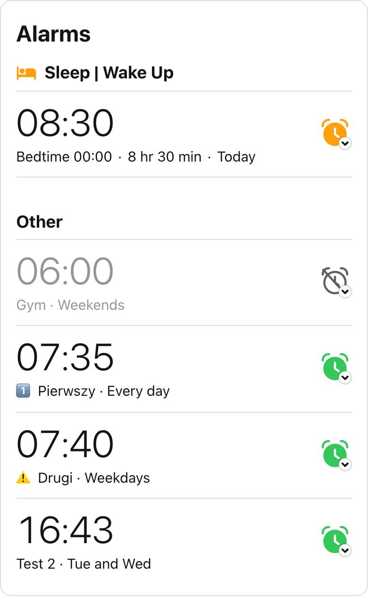

# Dashboard card

The **iPhone Alarms** card lists your alarms the way the Clock app does. It is read-only: it shows what the phone last sent and changes nothing.

<p align="center">
  <picture>
    <source media="(prefers-color-scheme: dark)" srcset="../assets/card-dark.png">
    
  </picture>
</p>

- **Sleep | Wake Up**: when the Wake-Up alarm last rang, when bedtime began before it, how long you slept in between, and on which day.
- **Other**: every alarm with its time, label and repeat days. The clock on the right is green when the alarm is on, and crossed out, with grayed-out text, when it is off. The arrow in its corner shows whether the alarm is open.
- **Tap an alarm** for the rest: whether snooze is allowed, when it rings next, when it last went off, was snoozed and was stopped, and the automations and scripts that use it. Tap an automation to open it. Admins also get **Open device**, the alarm's device page.

## Add the card

The card comes with the integration. There is nothing to download or add under Resources.

1. Open a dashboard, then **Edit dashboard** → **Add card**.
2. Search for **iPhone Alarms** and pick it.
3. Change the options if you like, then **Save**.

Or in YAML:

```yaml
type: custom:iphone-alarms-card
```

## Options

All of them can be set in the card editor.

| Option | Default | What it does |
|---|---|---|
| `title` | none | A title above the list, such as `Alarms`. Leave it out for a more compact card. |
| `devices` | all | Phones or single alarms to show. A phone shows all its alarms and its Sleep section. An alarm shows only that alarm. |
| `show_sleep` | `true` | Show the Sleep \| Wake Up section. |
| `show_disabled` | `true` | Show alarms that are off. |
| `show_automations` | `true` | Tapping an alarm shows the automations and scripts that use it. |
| `show_last_events` | `true` | Tapping an alarm shows when it last went off, was snoozed and was stopped. |

**Examples**

One phone, without the alarms that are off:

```yaml
type: custom:iphone-alarms-card
title: Alarms
devices:
  - 1a2b3c4d5e6f # the phone's device ID; pick it in the editor
show_disabled: false
```

Two alarms only, without Sleep:

```yaml
type: custom:iphone-alarms-card
devices:
  - 7a8b9c0d1e2f # an alarm's device ID
  - 3f4e5d6c7b8a
```

## Where the data comes from

- **Alarms** come from the Sync shortcut, so the card shows the state of the last sync.
- **Sleep | Wake Up** and the **last events** come from the [event shortcuts](shortcuts.md). Without them, the Sleep section stays hidden and an alarm shows *No events yet*.
- iOS shares no Sleep schedule with Shortcuts, so the Sleep section shows the last night that happened, not the next one.
- Times follow your Home Assistant profile: 12 or 24 hours, and the server's or the browser's time zone.

**Full history.** The card shows only the latest event of each kind. For a list over a period of time, add a Logbook card with the alarms' event entities:

```yaml
type: logbook
hours_to_show: 48
target:
  entity_id:
    - event.johns_iphone_wake_up_alarm
    - event.johns_iphone_1_pierwszy_alarm
```

## Limits

- **Automations of Sleep | Wake Up**: the card finds automations that use the phone's *Wake-Up alarm* or *Sleep* event entities. It misses device triggers on the phone itself, such as *Wake-Up alarm goes off*: telling those apart from *any alarm* needs admin rights. A line under the list says so.
- **Automations of an alarm**: the card finds every automation and script that uses the alarm's device or one of its entities, through Home Assistant's own search.
- **An alarm is missing**: it needs its **Alarm ID** sensor. If you disabled that entity, the card can't read the alarm.

## Change the look

The card follows your theme. It works with [card-mod](https://github.com/thomasloven/lovelace-card-mod) and with themes through these variables:

| Variable | Default | Changes |
|---|---|---|
| `--iphone-alarms-accent` | `#ff9f0a` | The bed icons and the Sleep clock |
| `--iphone-alarms-time-size` | `2.5rem` | The size of the times |
| `--iphone-alarms-time-weight` | `300` | The weight of the times |
| `--iphone-alarms-row-padding` | `10px 0 12px` | The space around each alarm |
| `--iphone-alarms-disabled-opacity` | `0.45` | How gray an alarm that is off looks |
| `--iphone-alarms-on-color` | `#34c759` | The clock of an alarm that is on |
| `--iphone-alarms-panel-color` | light gray | The background of an open alarm's details |

```yaml
type: custom:iphone-alarms-card
card_mod:
  style: |
    ha-card {
      --iphone-alarms-accent: var(--primary-color);
      --iphone-alarms-time-size: 2rem;
    }
```

The class names inside the card (`.section`, `.section-header`, `.row`, `.time`, `.subtitle`, `.status`, `.details`, `.automation`) stay stable, for those who style deeper with card-mod.

## Troubleshooting

- **"Custom element doesn't exist: iphone-alarms-card"** after an update: reload the page. In the app, go to Settings → Companion App → Debugging → Reset frontend cache.
- **No alarms yet**: run the Sync shortcut on the phone (close the Clock app).
- **"1 selected device no longer exists"**: an alarm was deleted on the phone. Edit the card and remove it from `devices`.
